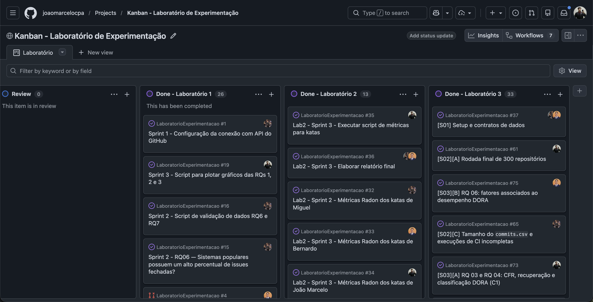
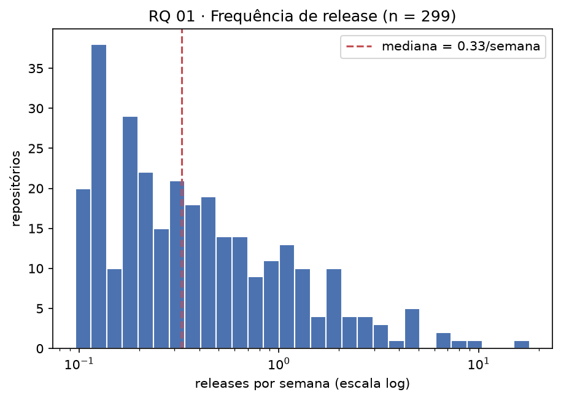
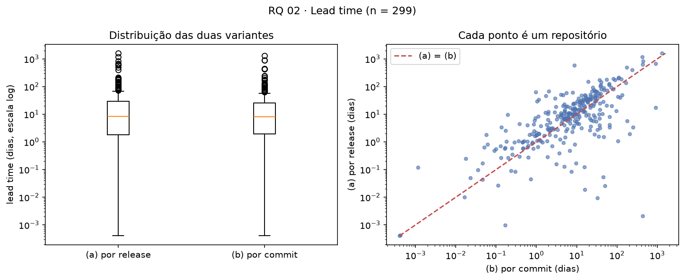
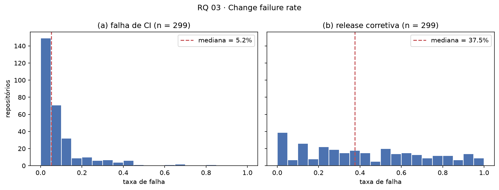
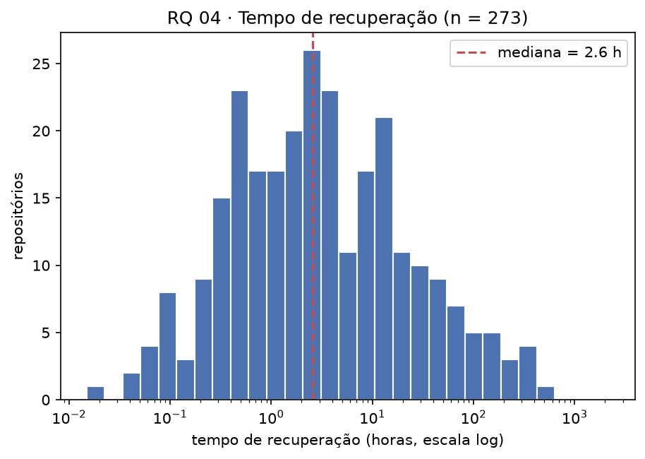
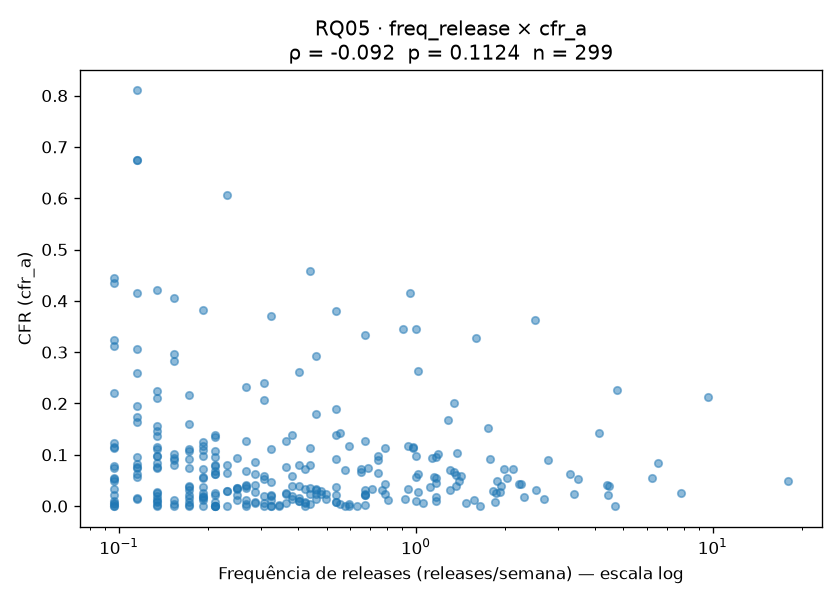
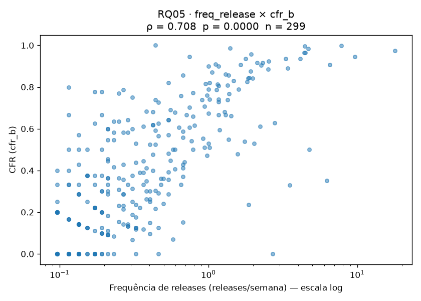
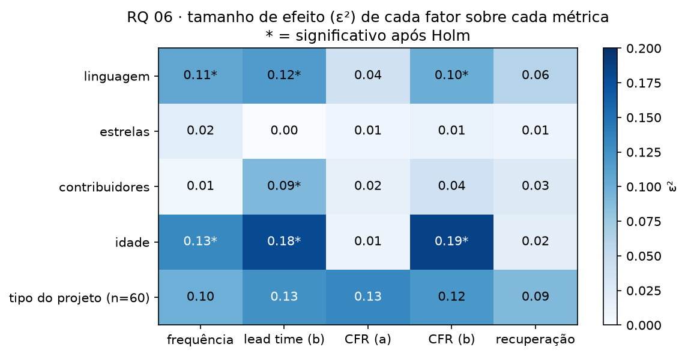
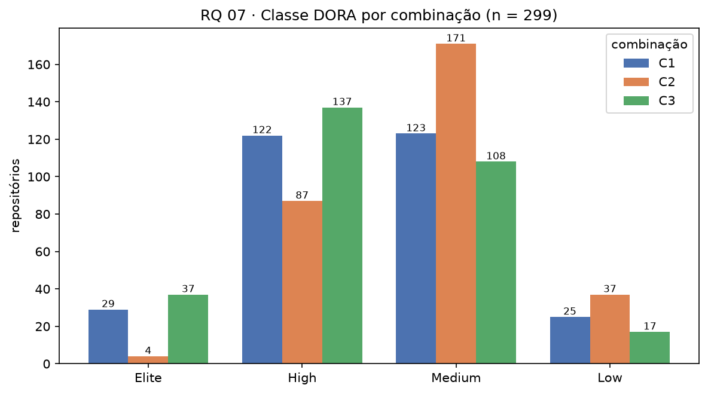
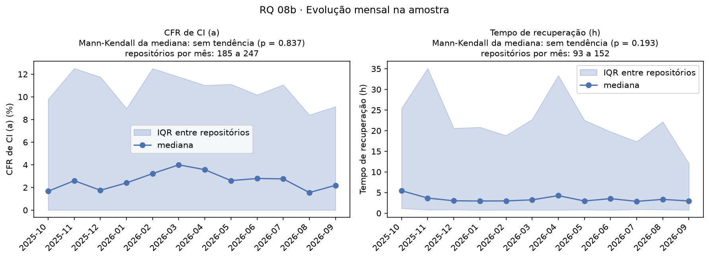

# Laboratório 03 — Mineração de Métricas DORA em Repositórios Open-Source

| | |
|---|---|
| **Curso** | Engenharia de Software |
| **Disciplina** | Laboratório de Experimentação de Software |
| **Turno / Período** | Noite / 6º |
| **Professor** | Danilo Maia |
| **Laboratório** | Lab03 — Mineração de métricas DORA |
| **Grupo** | João Marcelo (A) · Bernardo (B) · Miguel Diniz (C) |
| **Repositório** | https://github.com/joaomarcelocpa/LaboratorioExperimentacao (pasta `Laboratorio3/`) |
| **Painel interativo das RQs** | https://joaomarcelocpa.github.io/LaboratorioExperimentacao/Laboratorio3/dashboard/ |
| **GitHub Projects** | [preencher o link do board] |
| **Data de entrega** | [preencher] |

---

# 1. Introdução

As métricas DORA (*deployment frequency*, *lead time for changes*, *change failure rate* e tempo de recuperação) são o padrão de mercado para medir o desempenho de entrega de software. O GitHub, porém, não registra "deploys em produção" nem "falhas em produção". Neste laboratório as métricas foram **inferidas por proxies**: release publicada como deploy, execução de CI com falha como falha. Por isso o estudo pergunta duas coisas: *qual é o valor da métrica?* e *o quanto podemos confiar nele?* (validação manual e análise de sensibilidade).

**Questões de pesquisa e hipóteses** (registradas antes da análise; as das RQ 03a, 04, 05 e 08b foram registradas depois da coleta, sem ajuste aos resultados, e isso é uma ameaça à validade. Texto completo em `docs/hipoteses.md`):

| RQ | Pergunta | Hipótese informal |
|---|---|---|
| 01 | Qual a frequência de deploys? | Mediana entre 0,25 e 1 release/semana; poucos Elite |
| 02 | Qual o tempo entre commit e deploy? | Mediana de 1 a 7 dias; variante por commit menor que por release |
| 03 | Qual a taxa de falha das mudanças? | CFR de CI entre 10% e 25%; CFR por release abaixo de 30% |
| 04 | Qual o tempo de recuperação após falha de CI? | Mediana abaixo de 1 dia, com cauda longa e censura relevante |
| 05 | Mais deploys implica mais ou menos falhas? | Correlação fraca e negativa (\|ρ\| < 0,3) |
| 06 | Que características associam-se a melhor desempenho? | Associações fracas (ε² < 0,06); poucos testes significativos após Holm |
| 07 | O quanto a classificação DORA depende da definição? | 30–50% mudam de classe; kappa entre 0,3 e 0,6 |
| 08 (bônus) | 08a: taxa de retrabalho; 08b: evolução temporal | 08a: retrabalho ≥ CFR (b) + 5 p.p.; 08b: maioria sem tendência |

**Contribuições além do enunciado** (detalhadas em 3.6): cinco versões da heurística de release corretiva validadas contra a amostra-ouro, CFR por issues de bug (c), CFR de CI sem falhas *flaky*, lead time sem bots, filtro preguiçoso com semente fixa na seleção e painel web das RQs.

# 2. Contexto

Este é o terceiro laboratório da disciplina e muda o objeto de estudo: em vez de repositórios populares em geral (Lab01) ou katas (Lab02), são **repositórios open-source reais com GitHub Actions**, minerados para calcular as métricas do livro *Accelerate* (Forsgren, Humble & Kim, 2018) e dos relatórios *State of DevOps* do DORA. As definições operacionais são as comuns da turma: janela de 12 meses (**1/out/2025 a 30/set/2026**), apenas o *default branch*, deploy = release publicada (`draft = false`), data do commit = `author.date`, CI = runs de `push`, e classificação Elite/High/Medium/Low pelos cortes fixos do enunciado.

# 3. Metodologia

## 3.1 Principais desafios

- **Teto de 1.000 resultados da API.** A busca de candidatos foi fatiada por faixas de estrelas (65.450 candidatos). Nos runs de CI, a janela foi bisseccionada até fatias de ~40 minutos; mesmo assim 69 intervalos (11 repositórios; `pytorch/pytorch` 24, `dust-tt/dust` 15, `twentyhq/twenty` 10, `openai/codex` 8) continuaram saturados e ficaram incompletos. Estão registrados em `fatias_saturadas.csv`.
- **Custo de cota.** Examinar 37 mil candidatos levaria dias de cota. Solução: pré-filtro por `pushed_at` e exame em ordem aleatória (seed 42) até fechar 300 aprovados (#58).
- **Volume de dados.** `commits.csv` (244 MB) e `runs.csv` (114 MB) passam do limite do GitHub e são versionados em `.gz` determinístico (#65).
- **Monorepos e tags com `/` ou `#`** quebravam o `compare` (erro 422, #56); tags passaram a ser codificadas na URL. Monorepos foram mantidos e registrados como ameaça (#63).
- **Heurística de release corretiva** não atingiu o F1 de 0,70 exigido (ver 3.2 e 4.1).

## 3.2 Tomadas de decisão

| Decisão | Justificativa |
|---|---|
| Amostra aleatória simples, **não estratificada** | As primeiras 300 aprovações de uma ordem aleatória fixa são amostra uniforme dos aprovados; reprodutível pela seed |
| Análise sobre **299 de 300** repositórios | Um repositório não teve coleta completa |
| Métrica ausente fica vazia (NaN), nunca zero | Evita distorcer mediana e IQR; cada análise informa seu *n* |
| Mediana e IQR em todas as RQs | Distribuições muito assimétricas |
| Heurística de release corretiva **v5** | Maior F1 entre cinco versões testadas (alto recall, precisão baixa) |
| Tipo do projeto como fator da RQ 06, **só nos 60 da amostra-ouro** | O rótulo manual existe só para eles; resultado tem pouco poder |
| RQ 08b: Mann-Kendall **mensal** (12 pontos) | Com 4 trimestres o menor p possível é ≈ 0,08, nenhum repositório poderia ser significativo |
| Desempate da conferência: maioria 2-1; 1-1-1 decidido em reunião | `docs/protocolo_desempate.md` |

## 3.3 Etapas

| Sprint | Entregas | A (João) | B (Bernardo) | C (Miguel) | Issues |
|---|---|---|---|---|---|
| **S01** | Pipeline para 100 repositórios, testes, CI, hipóteses | seleção, funil, metadados, CFR por issues, classificação | releases/tags/commits, frequência, lead time, corretiva | cliente HTTP/cache, runs, CFR de CI, recuperação | #37–#48 |
| **S02** | 300 repositórios, métricas, validação manual, metodologia | rodada final, ferramentas da amostra-ouro | monorepos, regra corretiva | `commits.csv`, dataset e dicionário | #56, #58, #61–#67 |
| **S03** | Análise das RQ 01–07 e bônus, painel | RQ 01–04 e classe C1 | RQ 05 e 06 | RQ 07 e 08 | #72–#79 |

**Configuração do processo.** O board é um GitHub Projects (v2) único para os três laboratórios, "Kanban - Laboratório de Experimentação", com a visão "Laboratório". O print mostra o fim do fluxo: a coluna *Review* (0 itens) e uma coluna *Done* por laboratório, com 26 itens no Laboratório 1, 13 no Laboratório 2 e **33 no Laboratório 3**, todos concluídos. Os cartões trazem o número da issue e o avatar do responsável. [Preencher: colunas anteriores a Review (Backlog, To Do, Doing) e a política de limite de WIP.]

## 3.4 Ferramentas

Python 3.12; `requests` (REST) e GraphQL do GitHub com cliente próprio (sem PyGithub); SQLite para cache e retomada; pandas, SciPy, statsmodels, scikit-learn e `pymannkendall` para estatística; matplotlib para os gráficos; pytest + pytest-cov (cobertura mínima de 80%) e GitHub Actions para CI; Docker e `make` para reprodução (`make run`, `make reproduce`, `make dashboard`).

## 3.5 Tabela de métricas

| RQ | Métrica | Definição operacional | Unidade |
|---|---|---|---|
| 01 | Deployment frequency | releases publicadas na janela ÷ 52,1 semanas | releases/semana |
| 02a | Lead time por release | `published_at(R)` − data do commit mais antigo de R; mediana das releases | dias |
| 02b | Lead time por commit | `published_at(R)` − data de cada commit de R; mediana de todos | dias |
| 03a | CFR de CI | falhas ÷ (falhas + sucessos) dos runs de push no default branch | % |
| 03b | CFR por release | releases seguidas de corretiva em ≤ 7 dias ÷ releases avaliadas | % |
| 04 | Tempo de recuperação | fim do 1º sucesso após falha − início da 1ª falha, por workflow; mediana do repositório | horas |
| 05 | Spearman | ρ entre frequência (RQ 01) e CFR (a) e (b) | ρ |
| 06 | Kruskal-Wallis + ε² + Holm | métricas × fatores (quartis ou grupos) | ε² |
| 07 | % que muda de classe, κ ponderado linear | C1, C2, C3 | % / κ |
| 08a | Taxa de retrabalho (*rework rate*) | releases corretivas ÷ releases avaliadas, sem limite de dias | % |
| 08b | Mann-Kendall mensal | por repositório, α = 0,05, Holm por métrica | direção |

## 3.6 Inovações propostas pelo grupo

| Inovação | O que foi feito | Onde aparece |
|---|---|---|
| Heurística corretiva v1–v5 | Cinco versões comparadas à amostra-ouro (P/R/F1) | 4.1, RQ 03 |
| CFR de CI sem *flaky* | Remove falhas seguidas de sucesso no mesmo `head_sha` | RQ 03 |
| CFR por issues de bug (c) | Terceiro proxy de falha, via labels de bug | RQ 03 |
| Lead time sem bots | Variante que exclui commits de bots | RQ 02 |
| Taxa de retrabalho e taxa de retrabalho em 7 dias | Bônus 08a | RQ 08 |
| Seleção preguiçosa com seed | Reduz custo de cota sem alterar quem pode entrar | 4.1 |
| Painel web das RQs | Página estática com hipótese, veredito e gráficos | link no topo |

# 4. Resultados

## 4.1 Coleta de dados

**Funil de seleção** (seed 42; janela 1/10/2025 a 30/9/2026):

| Etapa | Entraram | Saíram |
|---|---:|---:|
| Candidatos da busca (≥ 1.000 estrelas) | 65.450 | |
| Duplicatas / forks / arquivados | 65.450 | 26 / 0 / 5.361 |
| Sem push na janela | 60.063 | 22.710 |
| **Elegíveis** | **37.353** | |
| Não examinados (amostra fechou antes) | 37.353 | 35.999 |
| Examinados | 1.354 | |
| Não usa GitHub Actions | 1.354 | 240 |
| Menos de 5 releases | 1.114 | 711 |
| Menos de 50 runs válidos | 403 | 103 |
| **Aprovados (22% dos examinados)** | **300** | |

Dataset: **299 repositórios analisados**, 16.536 releases, 13.745 episódios de falha de CI. Ausências: tempo de recuperação em 26 repositórios (sem falha de CI) e CFR por issues em 77.

**Validação manual (amostra-ouro: 60 repositórios, 300 releases, 3 avaliadores independentes):**

| Dimensão | κ de Fleiss | Leitura |
|---|---:|---|
| Tipo do projeto | 0,885 | quase perfeita |
| Entregas reais | 0,236 | razoável (95% unânimes; κ baixo pela pouca variação nas respostas) |
| Release corretiva | 0,661 | substancial |

**Heurística de release corretiva** (releases decidíveis, n = 240):

| Versão | F1 | Precisão | Recall |
|---|---:|---:|---:|
| v1 | 0,604 | 0,443 | 0,949 |
| v2 | 0,535 | 0,519 | 0,551 |
| v3 | 0,605 | 0,487 | 0,796 |
| v4 | 0,607 | 0,442 | 0,969 |
| **v5 (adotada)** | **0,638** | **0,475** | **0,969** |

Nenhuma versão chegou ao F1 de 0,70. A v5 acerta quase todas as corretivas, mas marca muitas releases normais como corretivas; **o CFR (b) deve ser lido como limite superior**.

## 4.2 Resultados por RQ

Todas as figuras estão em `analise/saida/figuras/` e as tabelas em `analise/saida/tabelas/` (regeneráveis com `make reproduce`).

### RQ 01 — Frequência de deploy

| | n | Mediana | IQR |
|---|---:|---:|---|
| Releases/semana | 299 | **0,33** | 0,17 – 0,76 |

| Faixa DORA | Repositórios | % |
|---|---:|---:|
| Elite (≥ 7/sem) | 3 | 1,0% |
| High (1–7/sem) | 56 | 18,7% |
| Medium (1/mês–1/sem) | 121 | 40,5% |
| Low (< 1/mês) | 119 | 39,8% |

**Hipótese confirmada.** Mediana dentro de 0,25–1, só 3 Elite, média (0,79) acima do dobro da mediana. Contar tags ou pré-releases sobe a mediana (0,44 e 0,38), sem mudar de faixa.

### RQ 02 — Lead time

| Variante | Mediana (dias) | IQR (dias) |
|---|---:|---|
| (a) por release | **8,3** | 1,8 – 29,3 |
| (b) por commit | **8,1** | 1,9 – 25,6 |

(a) é maior que (b) em 66% dos repositórios; só 27,8% estão entre 1 e 7 dias. Sem commits de bots, a mediana de (b) cai para 7,7 dias.

**Hipótese parcial.** A direção (b < a) se confirma, mas a diferença na mediana é de só 2,4%. O nível erra: a mediana está na faixa Medium (acima de 7 dias), não High.

### RQ 03 — Taxa de falha (CFR)

| Variante | n | Mediana | IQR | Faixa DORA |
|---|---:|---:|---|---|
| (a) CI | 299 | **5,2%** | 1,9% – 10,7% | Elite |
| (b) release corretiva | 299 | **37,5%** | 16,7% – 66,0% | Medium |
| (c) issues de bug (extra) | 222 | 37,4% | 9,3% – 77,8% | |

Falhas *flaky* são 3,5% das falhas (mediana); removê-las muda a mediana do CFR (a) de 6,1% para 5,5% (−0,7 p.p.).

**Hipótese refutada.** 73,6% dos repositórios têm CFR (a) abaixo de 10% (previsto: 10–25%) e só 38,8% têm CFR (b) abaixo de 30% (previsto: maioria). A expectativa de queda perceptível sem *flaky* não se confirmou. A diferença entre (a) e (b) é de sete vezes: o resultado depende do proxy, e o (b) tem a precisão limitada vista em 4.1.

### RQ 04 — Tempo de recuperação

| | n | Mediana | IQR |
|---|---:|---:|---|
| Recuperação (h) | 273 | **2,6** | 0,6 – 13,2 |

51% dos repositórios estão na faixa High (1 h a 1 dia); 44 têm mediana acima de 1 dia e 9 acima de 1 semana. Apenas 76 dos 13.745 episódios (0,6%) foram censurados, e 3 são só de *flaky*.

**Hipótese parcial.** Mediana abaixo de 1 dia e cauda longa se confirmam. A censura relevante e o aumento da mediana sem *flaky* (2,6 h para 2,5 h) não se confirmam.

### RQ 05 — Frequência × CFR

| CFR | ρ de Spearman | p | n |
|---|---:|---:|---:|
| (a) CI | −0,092 | 0,11 | 299 |
| (b) release | **+0,708** | < 0,001 | 299 |

| CFR (a) | CFR (b) |
|---|---|
|  |  |

**Hipótese parcial.** Com o CFR (a), a relação é fraca e negativa, mas não significativa: não há sinal de *trade-off*, em linha com o DORA. Com o CFR (b) o sinal inverte e é forte. Provável explicação (não testada): é parcialmente mecânico, porque quem publica mais tem mais chance de ter outra release em até 7 dias, e a heurística lê isso como correção. Correlação não implica causalidade.

### RQ 06 — Fatores associados ao desempenho

Kruskal-Wallis, 5 fatores × 5 métricas = 25 testes, correção de Holm. **7 dos 25 são significativos**; 13 têm ε² < 0,06.

| Fator | Resultado significativo após Holm |
|---|---|
| **Idade** | frequência (ε² 0,13), lead time (0,18), CFR (b) (0,19) |
| **Linguagem** | frequência (0,11), lead time (0,12), CFR (b) (0,10) |
| Contribuidores | só lead time (0,09) |
| Estrelas | nenhum |
| Tipo do projeto (n = 60) | nenhum |

Mediana de frequência por quartil de idade (Q1 mais novo → Q4 mais velho): 0,90 → 0,31 → 0,27 → 0,21 releases/semana; lead time por commit: 1,9 → 8,1 → 13,2 → 21,3 dias; CFR (b): 70% → 36% → 27% → 33%. Por linguagem, TypeScript tem 0,58/semana e C++ 0,16.

**Hipótese parcial.** Confirmado: estrelas sem efeito e linguagem acima de C++. Refutado: a idade tem o **maior** efeito (esperado pequeno) e contribuidores não afetam frequência. Automação de release e Conventional Commits foram coletados (`repos.csv`) mas **não entraram nos testes**. Os testes só detectam diferença entre grupos; a direção vem das medianas.

### RQ 07 — Sensibilidade da classificação DORA

| Combinação | Deploy | Lead time | CFR |
|---|---|---|---|
| C1 (referência) | release | (a) | (a) |
| C2 | release + pré-release | (b) | (b) |
| C3 | tag | (b) | (a) |

| Par | Mudaram de classe | κ ponderado | Leitura |
|---|---:|---:|---|
| C1 × C2 | 137 (45,8%) | 0,316 | razoável |
| C1 × C3 | 82 (27,4%) | 0,656 | substancial |
| C2 × C3 | 127 (42,5%) | 0,405 | moderada |

165 repositórios (55,2%) mudam de classe em pelo menos um par. Percentual de repositórios cuja nota muda ao trocar a definição: **CFR 78,6%**, lead time 47,8%, unidade de deploy 7,4% a 18,7%.

**Hipótese parcial.** Kappas ficam na faixa prevista e nenhum é quase perfeito, mas a mudança total (55%) passa do previsto, e o fator dominante é o **CFR**, não lead time nem unidade de deploy. Robustez das demais RQs: frequência e lead time sobrevivem na mediana (ambos Medium); CFR, o sinal da RQ 05 e a significância da RQ 06 para CFR **dependem da definição**. A recuperação não foi variada (as três combinações usam a mesma). A C3 não é uma definição "por tag" completa: o lead time (b) continua medido sobre commits entre releases.

### RQ 08 (bônus) — Taxa de retrabalho e evolução temporal

**08a — Taxa de retrabalho (*rework rate*).** Mediana de 100% contra 37,5% do CFR (b), diferença de 62,5 p.p.; 51,5% dos repositórios têm todas as releases avaliadas como corretivas. A hipótese (≥ 5 p.p.) é confirmada, mas a métrica sem limite de dias **satura e deixa de discriminar**; com limite de 7 dias ela coincide com o CFR (b). Análise exploratória, calculada para o painel (`dashboard/`).

**08b — Evolução temporal.** Mann-Kendall mensal por repositório (α = 0,05):

| Métrica | Testados | Melhora | Piora | Sem tendência | Com Holm (melhora / piora) |
|---|---:|---:|---:|---:|---|
| CFR de CI (a) | 211 | 12 (5,7%) | 11 (5,2%) | 188 (89,1%) | 0 / 1 |
| Recuperação | 94 | 4 (4,3%) | 2 (2,1%) | 88 (93,6%) | 0 / 0 |

A série mensal da mediana entre repositórios também não tem tendência (p = 0,84 no CFR; p = 0,19 na recuperação). Frequência por trimestre, descritivo: 0,15 → 0,31 → 0,31 → 0,38 releases/semana.

**Hipótese parcial.** "Maioria sem tendência" confirmada. "Mais melhora do que piora" não se sustenta: 12 contra 11 no CFR, e com Holm sobra só uma piora. A recuperação cobre apenas 94 repositórios (os de CI mais instável), e com 12 pontos por série "sem tendência" significa "não detectável".

## 4.3 Discussão

| RQ | Hipótese | Veredito | O que surpreendeu |
|---|---|---|---|
| 01 | 0,25–1 release/semana, poucos Elite | **Confirmada** | Nada: 40% ficam em Low |
| 02 | 1–7 dias; (b) < (a) | Parcial | Mediana de 8 dias; as variantes quase não diferem |
| 03 | CFR (a) 10–25%; (b) < 30% | **Refutada** | CI muito estável (5%) e (b) muito alto (38%) |
| 04 | < 1 dia, cauda longa, censura relevante | Parcial | Censura quase nula (0,6%) |
| 05 | ρ fraco e negativo | Parcial | ρ = +0,71 com o CFR (b) |
| 06 | efeitos fracos | Parcial | Idade é o fator mais forte (ε² até 0,19) |
| 07 | 30–50% mudam; κ 0,3–0,6 | Parcial | Quem pesa é o CFR, não lead time |
| 08 | 08a retrabalho > CFR (b); 08b sem tendência | Parcial | O retrabalho satura em 100% |

**Leitura geral.** O desempenho típico da amostra é *Medium/High*: releases a cada três semanas, lead time de ~8 dias, CI que quebra pouco (5%) e se recupera em poucas horas. O que mais pesa é a **definição de falha**: CFR (a) e (b) diferem sete vezes, mudam o sinal da correlação com a frequência e reclassificam 55% dos repositórios. Recomenda-se reportar sempre os dois lado a lado. A idade do repositório é o fator mais associado ao desempenho: repositórios novos publicam mais e entregam mais rápido, mas têm mais releases corretivas, o que é compatível com projetos jovens em iteração rápida.

**Ameaças à validade.**
- *Construto:* release ≠ deploy (subestima serviços com deploy contínuo e superestima bibliotecas com release automática); CFR de CI mede falha de pipeline, não de produção; `author.date` sofre com rebase e squash; heurística corretiva com F1 de 0,64 e rótulos de Bernardo divergentes dos de João e Miguel (171 contra 112 e 111 corretivas); labels de bug fixos deixam 77 repositórios sem CFR (c).
- *Interna:* 69 intervalos de CI incompletos em 11 repositórios afetam CFR (a), recuperação e série mensal; monorepos mantidos; hipóteses das RQ 03a, 04, 05 e 08b registradas depois da coleta; o efeito da idade pode estar confundido com a política de releases.
- *Externa:* só repositórios com ≥ 1.000 estrelas, com Actions e ≥ 5 releases na janela (22% dos examinados); amostra não estratificada (7 repositórios acima de 50 mil estrelas); popularidade medida na data da coleta.
- *Conclusão:* 25 testes na RQ 06 (corrigidos por Holm); tipo do projeto testado só em 60 repositórios; 12 pontos por série na RQ 08b; cortes DORA fixos e arbitrários na RQ 07.

**Replicação cruzada.** [Pendente: a entrega final exige executar o pipeline de outro grupo, comparar os resultados e registrar aqui o relato, além de responder às issues recebidas. Não há registro disso no repositório.]

# 5. Conclusão

Para os 299 repositórios populares com CI/CD analisados, a entrega típica é de uma release a cada três semanas (0,33/semana), com lead time de ~8 dias, CFR de CI de 5%, CFR por release de 38% e recuperação de 2,6 horas. A classe DORA de referência (C1) é Medium (41%) ou High (41%) para a maioria, com 10% Elite e 8% Low.

Sobre velocidade e estabilidade: pelo CI não há trade-off detectável (ρ = −0,09), mas pela release corretiva a relação é fortemente positiva (ρ = +0,71), provavelmente por artefato da medida. A conclusão depende do proxy, e a análise de sensibilidade mostra que o CFR é a escolha que mais reclassifica repositórios (55% mudam em algum par). Nas 8 RQs, 1 hipótese foi confirmada, 6 parcialmente e 1 refutada. Idade e linguagem são os fatores mais associados ao desempenho, e as métricas de CI não mostram tendência na janela.

**Limitações:** proxies de deploy e falha; heurística corretiva com F1 de 0,64 (abaixo do 0,70 exigido); CI incompleto em 11 repositórios; amostra limitada a repositórios populares.

**Com mais tempo:** melhorar a precisão da heurística corretiva (por exemplo, rotulando mais releases com critério comum), incluir automação de release e Conventional Commits nos testes da RQ 06, medir um lead time por tag completo e repetir a RQ 06 sob C2 e C3.

# 6. Referências

- Forsgren, N.; Humble, J.; Kim, G. *Accelerate: The Science of Lean Software and DevOps*. IT Revolution, 2018.
- DORA. *Accelerate State of DevOps* e guia das métricas: https://dora.dev/guides/dora-metrics-four-keys/
- Wohlin, C. et al. *Experimentation in Software Engineering*. Springer, 2012.
- Romano, J. et al. *Appropriate statistics for ordinal level data*. 2006.
- Landis, J. R.; Koch, G. G. *The measurement of observer agreement for categorical data*. Biometrics, 1977.
